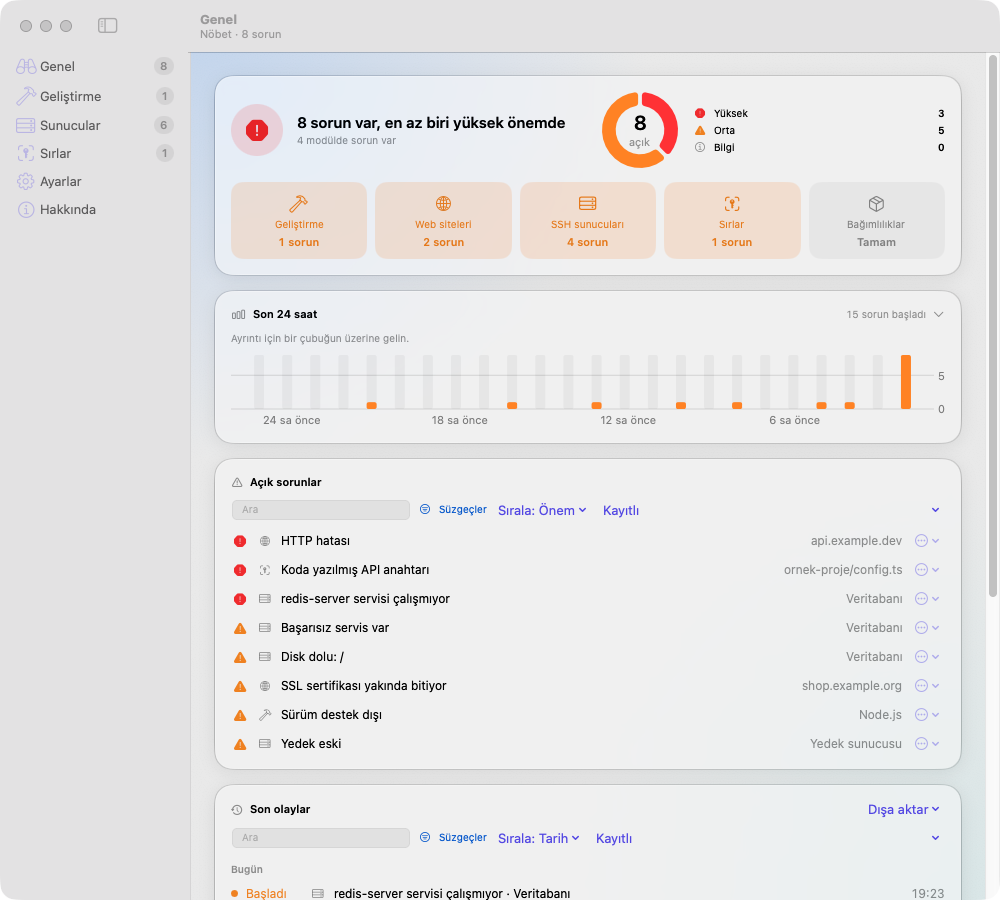
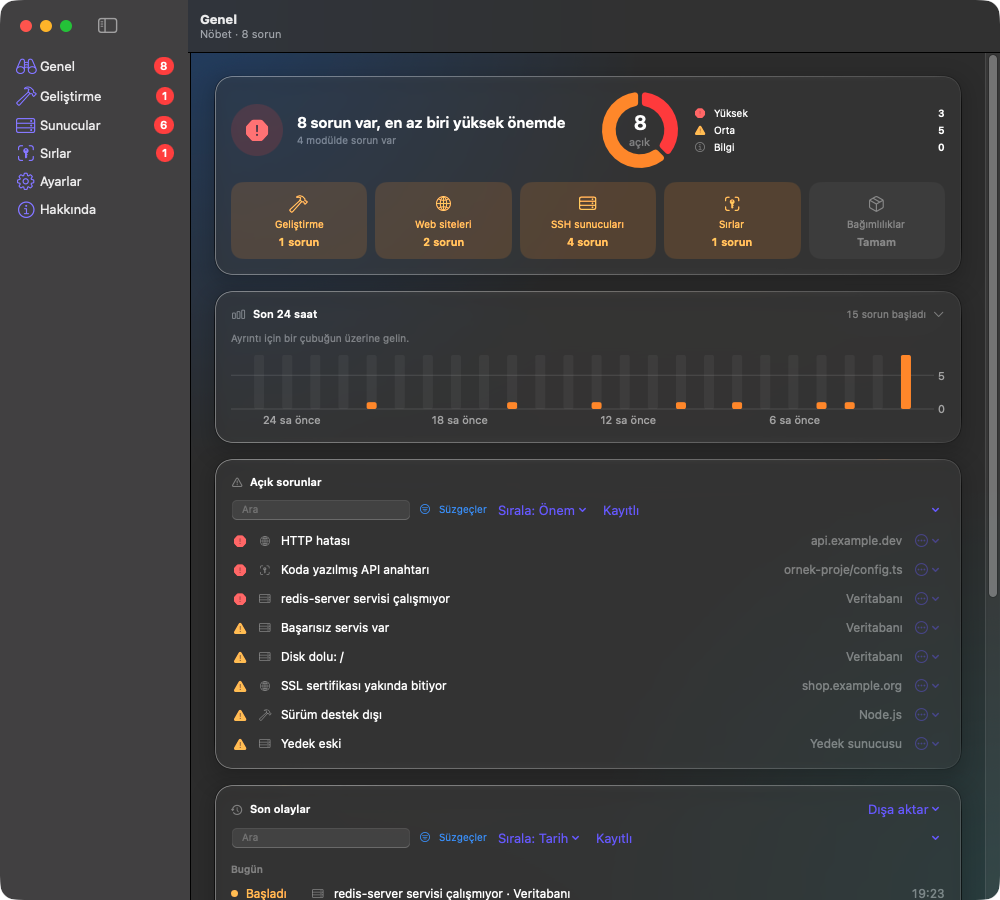
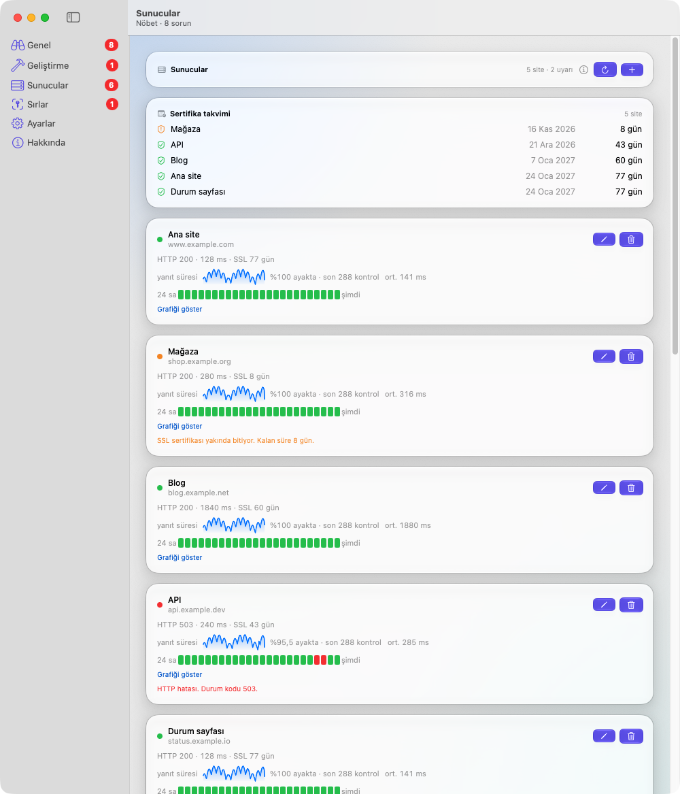
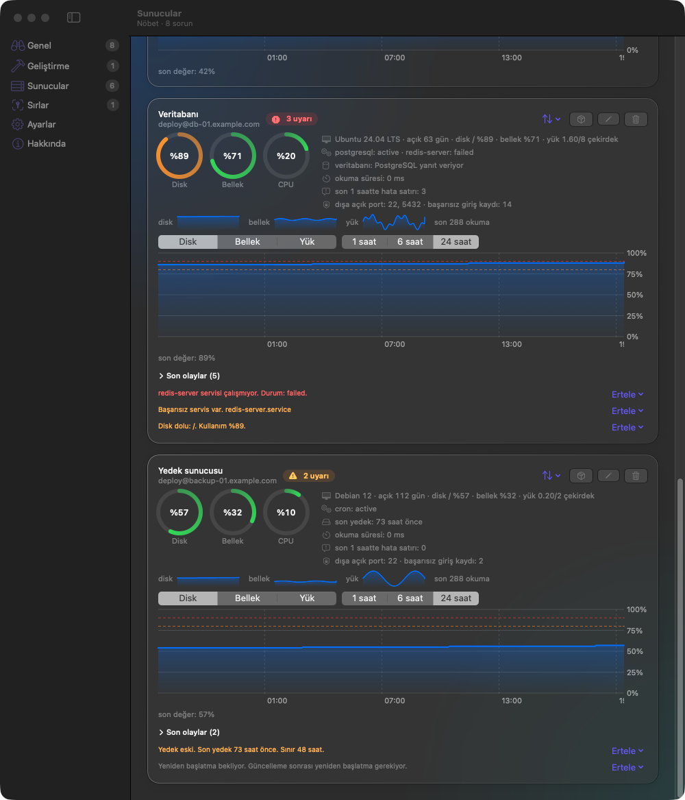
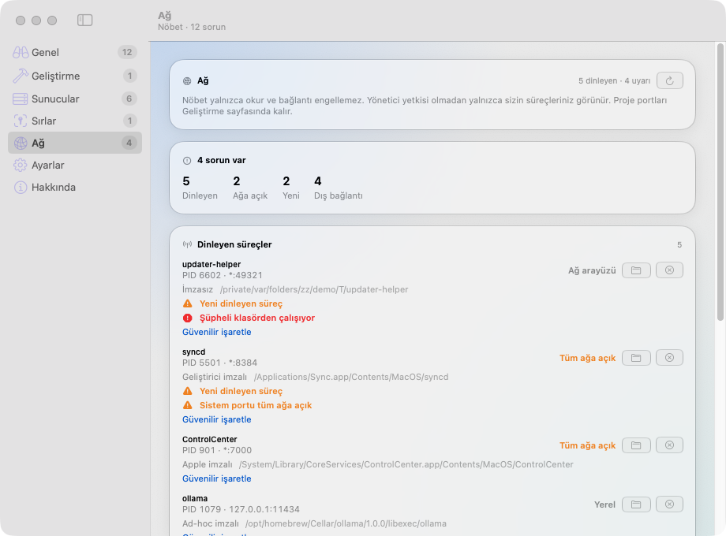
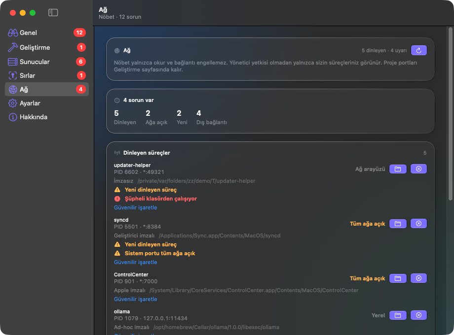
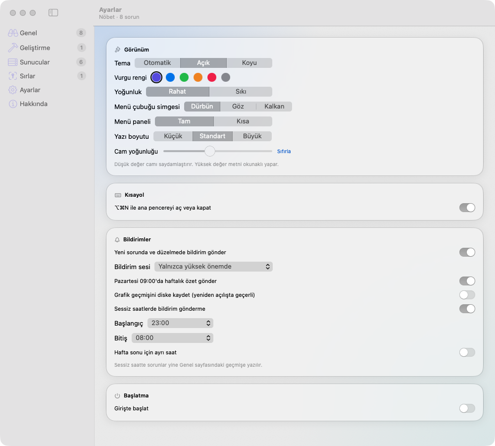

# Nöbet

Nöbet, macOS menü çubuğunda ve ana pencerede çalışır. Geliştirme ortamını, sunucuları ve yerel sırları izler.

Durum: tüm sayfalar çalışıyor. Windows sunucu ve otomatik güncelleme yapılmadı.

## Ekran görüntüleri

Tüm görüntüler sahte veriyle üretildi. Alan adları `example.*` adresleridir. Gerçek sunucu yoktur.

| Genel (açık) | Genel (koyu) |
|---|---|
|  |  |

| Sunucular: web siteleri | Sunucular: SSH sunucuları |
|---|---|
|  |  |

| Ağ (açık) | Ağ (koyu) |
|---|---|
|  |  |



### Demo kipi

`scripts/demo.sh` sahte veriyle çalışan ayrı bir kopya açar. Kopya `local.nobet.demo` paket kimliğini kullanır.
Gerçek Nöbet ayarlarına, Anahtar Zincirine ve ağa dokunmaz.

```bash
scripts/demo.sh -appearance.theme dark -mainSection Sunucular
```

Kip iki koşul birlikte olunca açılır: `NOBET_DEMO=1` ortam değişkeni ve demo paket kimliği.
Normal uygulamada kip kapalıdır.

## Modüller

| Sayfa | Durum | Ne yapacak |
|---|---|---|
| Genel | Çalışıyor | Modül durumu, açık sorunlar ve son 20 olay. Yeni sorunda ve düzelmede bildirim gönderir |
| Geliştirme | Çalışıyor | Docker/OrbStack konteynerleri, DDEV siteleri ve dinleyen portlar proje başına. Durdur, başlat ve sonlandır düğmeleri onay ister. Ağa açık proje portu menü çubuğunda uyarı sayısı olur |
| Sunucular | Çalışıyor | Dış kontrol: HTTP durumu, yanıt süresi, SSL bitiş tarihi. DNS, port ve zaman aşımı hatası ayrı bildirilir. SSH ile Linux sunucu: disk, bellek, yük, açık kalma süresi, servisler, sshd sertleştirme (root girişi, parola girişi, fail2ban), dışa açık portlar, Docker konteynerleri, veritabanı yanıtı, yedek tazeliği ve son 24 saatin çizgileri. Her kartta Düzenle düğmesi ve sunucu başına eşik vardır. Kimlik doğrulama hatasında o sunucunun otomatik yoklaması durur (fail2ban ve hesap kilidi riski). Elle yenileme veya Düzenle yoklamayı yeniden başlatır. Ağ hatasında bekleme 5, 10, 20, 40 dakika olur. Parola veya anahtar: parola yalnızca Anahtar Zincirinde durur. Windows yapılmadı |
| Sırlar | Hazır | `.env`, SSH anahtarı ve token dosyalarını tarar. Listede değer göstermez. Arama kutusu bulguları ve `~/.ssh` içindeki tüm özel anahtarları süzer. Anahtar kartı yalnızca yol ve izin gösterir, içeriği okumaz. Anahtarın yanında `.pub` dosyası varsa açık anahtarı kopyalayan düğme çıkar. İsteğe bağlı anahtar: "Kaynak kodda jeton ara" kod ve yapılandırma dosyalarında GitHub, AWS, Stripe gibi bilinen jeton biçimlerini arar. Varsayılan kapalıdır. Bulguda satır numarası ve sağlayıcı yazar, jeton değeri yazmaz. `.env` bulgusunda Düzenle düğmesi dosyayı satır satır düzenler: değerler gizli, kayıt modal onay ister. Diğer düzeltmeler için komut önerir, çalıştırmaz |
| Ağ | Çalışıyor | Dinleyen TCP süreçlerini, ikili dosya imzasını (Apple, geliştirici, ad-hoc, imzasız) ve kurulmuş bağlantıları gösterir. Uyarı kuralları: yeni dinleyen süreç, ağa açık sistem portu, ağa açık imzasız süreç, geçici veya İndirilenler klasöründen çalışan süreç. İlk tarama mevcut durumu sessizce öğrenir. Güvenilir işaretleme ve onaylı süreç sonlandırma vardır. Bağlantı engellemez. Proje portları Geliştirme'de kalır. Bağlantı listesi yalnızca sayfa açıkken okunur ve diske yazılmaz. Kısayol ⌘5 |
| Ayarlar | Çalışıyor | Kısayol ⌥⌘N, bildirimler, sessiz saatler (varsayılan 23:00–08:00), girişte başlatma |

## Gereksinimler

- macOS 15 veya üstü. Liquid Glass görünümü macOS 26 ve üstünde çalışır.
- Swift 6 araçları (Command Line Tools yeterlidir, Xcode gerekmez).

## İndirme

[Releases](https://github.com/osmanbarutcu/nobet/releases) sayfasından `Nobet-<sürüm>.dmg` dosyasını indirin.

1. DMG'yi açın. Nobet'i Applications klasörüne sürükleyin.
2. Uygulama notarize değildir. İlk açılışta sağ tıklayın, "Aç" seçin.
3. Sağlama için `.sha256` dosyasını kullanın: `shasum -a 256 -c Nobet-<sürüm>.dmg.sha256`

## Kurulum (kaynaktan)

1. Depoyu açın: `cd nobet`
2. Kurun: `./install.sh`

Betik uygulamayı derler, `/Applications/Nobet.app` altına kopyalar ve açar. Yalnızca derlemek için `./make-app.sh` çalıştırın.

## Kullanım

- Menü çubuğundaki dürbün simgesine tıklayın. Küçük panel açılır. Uyarı varsa simgenin yanında sayı görünür.
- `⌥⌘N` ana pencereyi açar veya kapatır.
- Ana pencereyi kapatınca uygulama çıkmaz. ⌘Q da yalnızca pencereleri kapatır. Uygulama menü çubuğunda çalışır. Tamamen çıkmak için panelde güç düğmesini kullanın.

## Geliştirme sayfası nasıl çalışır

- Portlar `lsof` ile okunur. Her sürecin çalışma klasöründen yukarı doğru ilk proje işareti aranır (`.git`, `package.json`, `composer.json`, `Package.swift` ve benzeri). Ev klasörü proje sayılmaz.
- Konteynerler `docker ps -a` ile okunur. Docker, OrbStack ve Docker Desktop yolları denenir. Konteyner DDEV etiketi veya compose klasörü üzerinden projesine bağlanır.
- Eylemler sabit bir listedir: `docker stop|start <ad>`, `ddev stop|start <ad>` ve `SIGTERM`. Komut kabuk olmadan çalışır. Ad doğrulanır. Onay penceresi çıkar.
- Sistem süreçleri (PID 1) ve Nöbet'in kendisi sonlandırılamaz. Yönetici yetkisi gerektiren süreç sonlanmaz.
- Okuma 60 saniyede bir yenilenir.

## Ağ sayfası nasıl çalışır

- Dinleyen portlar `lsof` ile 60 saniyede bir okunur. Süreç numarasından ikili dosya yolu (`proc_pidpath`) ve kod imzası (Security çerçevesi) bulunur. İmza sonucu dosya yoluna ve değişiklik zamanına göre saklanır.
- Dört kural uyarı üretir: yeni dinleyen süreç, ağa açık sistem portu, ağa açık imzasız süreç ve şüpheli klasörden çalışan süreç. Şüpheli klasör: `/tmp`, `/private/var/folders`, `Downloads` ve tanınmayan gizli klasör.
- Ad-hoc imza tek başına uyarı üretmez. Homebrew ikilileri ve Nöbet'in kendisi ad-hoc imzalıdır.
- Proje portları (çalışma klasörü bir projede) bu sayfada uyarı üretmez. Geliştirme sayfası onları zaten uyarır.
- Taban çizgisi süreç yolunu ve kapsamı (yerel, ağ arayüzü, tüm ağ) izler. Port numarasını izlemez. Birçok uygulama her açılışta rastgele port seçer.
- İlk tarama mevcut durumu sessizce öğrenir. Sonra yeni bir süreç dinlemeye başlarsa uyarı gelir. Güvenilir işaretlenen süreç hiçbir kuralı tetiklemez.
- Süreç sonlandırma `SIGTERM` gönderir ve onay ister. Apple sistem süreci için onay penceresi ek uyarı gösterir.
- Kurulmuş bağlantılar yalnızca sayfa açıkken 10 saniyede bir okunur. Liste diske yazılmaz.

## SBOM ve açık izleme

- Geliştirme sayfasındaki SBOM kartı `package-lock.json`, `composer.lock`, `Package.resolved` ve `requirements.txt` dosyalarını okur. CycloneDX 1.5 dışa aktarımı vardır.
- "Bilinen açıkları sorgula (OSV.dev)" varsayılan kapalıdır. Açıkken ekosistem, paket adı ve sürüm internete gider. Önem derecesi için açık kimliği de gider (en çok 50). Dosya yolu gitmez. Swift paketleri sorgulanmaz.
- Sorgu açıksa Nöbet açılışından 30 sn sonra, sonra 6 saatte bir kendiliğinden tarar. Sorgu kapalıysa ağa çıkmaz.
- Önceki taramada olmayan açıklı bileşen satırda "Yeni" görünür. İlk tarama mevcut durumu sessizce öğrenir. Diske yalnızca özet değerleri yazılır.
- Yüksek ve kritik açık yüksek önemli uyarı üretir. Diğerleri orta önemlidir. Düzeltme sürümü bilinirse uyarı konusuna eklenir.

## Güvenlik ilkeleri

- Ağ sayfası yalnızca okur. Taban çizgisi yalnızca özet değerleri saklar. Yol, süreç adı ve IP diske yazılmaz.
- Parola ve özel anahtar yalnızca macOS Anahtar Zinciri'nde durur. Uygulama klasöründe veya ayar dosyasında bulunmaz.
- Sunucularda yalnızca salt okunur komutlar çalışır. Betik bir testle denetlenir: `rm`, `sudo`, yazma yönlendirmesi ve servis durdurma yasaktır.
- Bildirim metni yol, anahtar adı veya sunucu çıktısı taşımaz. Geçmiş olayları yalnızca başlık ve konu saklar.
- SSH anahtarı `ssh-agent` üzerinden kullanılır. Nöbet gizli anahtar dosyasını okumaz.
- Sır tarayıcı değerleri listede göstermez ve kaydetmez. Tarama dosyayı değiştirmez. Dosyayı yalnızca `.env` düzenleme penceresi değiştirir.
- `.env` düzenleme: yalnızca düz `.env*` dosyası, en çok 256 KB, UTF-8. Sembolik bağlantı reddedilir. Değerler bellekte durur, pencere kapanınca gider. Bildirim ve mesajlar değer veya tam yol taşımaz.
- Düzenleme yazması atomiktir: aynı klasörde 0600 geçici dosya, özgün izinle `rename`. Dosya açıldıktan sonra değiştiyse kayıt reddedilir. Nöbet yedek tutmaz.

## Bilinen sınırlar

- Anahtar Zinciri erişimi imzaya bağlıdır (bu Mac'te ölçüldü, 8 deneme):
  - Apple Development sertifikasıyla imzalı uygulama yeniden derlenince kaydı okur. İstem çıkmaz.
  - Ad-hoc imza ikili dosyanın özetine (cdhash) bağlıdır. Yeniden derlenmiş ad-hoc uygulama eski kaydı okuyamaz (hata -25293, arayüz açık olsaydı macOS parola sorardı). Aynı kaynaktan aynı ikili çıktığında okuma çalışır.
  - Sertifikasız dağıtılan her yeni sürüm kayıtlı sunucu parolalarına erişemez. Kullanıcı parolaları yeniden girer. Çözüm: sürümü Developer ID ile imzalamak. Yapılmadı.
- Sertifika yoksa ad-hoc imza kullanılır. Bu durumda yukarıdaki kısıt geçerlidir.
- Notarization yapılmaz. Başka bir Mac'te Gatekeeper uyarı verebilir.
- Otomatik güncelleme yok. Yeni sürümü elle kurun.
- Önerilen komutlar (sshd, fail2ban, chmod) yalnızca metindir. Nöbet bunları çalıştırmaz.
- Ağ sayfası bağlantı engellemez. Engelleme `NetworkExtension` ve Developer ID imzası gerektirir. Yapılmadı.
- Ağ sayfası yönetici yetkisi olmadan yalnızca sizin süreçlerinizi görür. Yönetici (root) servisleri listelenmez.
- Zararlı bir süreç ilk taramadan önce çalışıyorsa taban çizgisi onu "bilinen" öğrenir. Şüpheli klasör ve imza kuralları bu süreci yine yakalar. Taban çizgisini sıfırlayarak yeniden öğretebilirsiniz.
- Bilinen bir süreç yeni bir porta geçerse yeni sayılmaz. Taban çizgisi port izlemez.

## Geliştirme

- Testleri çalıştırın: `swift test`. Testler Swift Testing kullanır. XCTest gerekmez.
- `swift test` `TestingMacros` eklenti hatası verirse: `swift test -Xswiftc -plugin-path -Xswiftc /Library/Developer/CommandLineTools/usr/lib/swift/host/plugins/testing`.
- `@State` bu derleme ortamında çalışmaz. Durumu `ObservableObject` içinde tutun.
- Pencere kapanınca çıkmama sınaması: `NOBET_DIAG_CLOSE_MAIN=1 Nobet.app/Contents/MacOS/Nobet`. Ana pencere 3 sn sonra kapanır. Uygulama yaşamalıdır.
- DMG üretin: `./make-app.sh`, ardından `./scripts/make-dmg.sh`.
- Anahtar Zinciri sınaması: `NOBET_DIAG_KEYCHAIN=write|read|delete Nobet.app/Contents/MacOS/Nobet`. Sahte `diag-spike` kaydını işler ve çıkar. Arayüz istemi kapalıdır.
